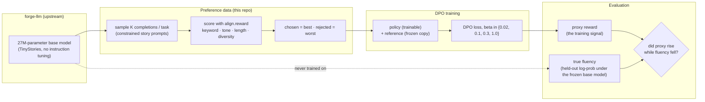

<div align="center">

# Forge-Align

**DPO alignment, from scratch, for [Forge](https://github.com/EllE961/forge-llm) -- and the reward hacking it causes, measured and shown, not just claimed.**


</div>

Most "I built a language model from scratch" projects stop at pretraining. This one asks the next question: once you
*align* that model to follow an instruction, does it actually get better at it, or does it just get better at
*looking like* it satisfies whatever you're measuring? Both DPO and the measurement that catches it are implemented
here from first principles, on top of [`forge-llm`](https://github.com/EllE961/forge-llm), the 27M-parameter
Llama-style model I trained from scratch in that repo.

## The setup

- **Task:** constrained story generation -- *"write a short story about a `dragon` that ends `happy`"* -- given to a
  **base model that was never instruction-tuned**. Forge only ever learned to continue TinyStories text, so it
  satisfies these constraints by chance, not by training. That's deliberate: it means alignment here has to teach
  instruction-following itself, not just adjust an already-compliant model's tone.
- **Reward, written from scratch, with no external judge and no human labels:** does the story contain the keyword
  (with simple morphological variants), does its last sentences match the requested tone (a small hand-built
  happy/sad lexicon), is it close to a target length, and is it free of the degenerate repetition loops small LMs
  fall into. Every sub-score is in `[0, 1]`; see `align/reward.py`.
- **The reward deliberately never checks fluency.** Fluency is measured only at evaluation time, as the average
  log-probability of the generated text under the *original, frozen* base model -- a signal DPO never sees during
  training. If DPO pushes the proxy reward up while this independent fluency score falls, that's reward hacking,
  and this repo is built specifically to catch it if it happens, not to hide it if it does.
- **Preference pairs, built without a reward model or human raters:** sample K completions per task from the base
  model, score each with the reward above, and take the best-scoring completion as "chosen" and the worst as
  "rejected" (`align/preference_data.py`). Tasks where every sample scores the same are skipped -- no signal to
  train on, so no pair is manufactured.
- **DPO (Rafailov et al., 2023), from scratch:** no reward model, no PPO rollouts. A frozen reference copy of the
  base model and a trainable policy are compared directly through the closed-form optimal-policy substitution that
  turns reward maximisation into a classification loss (`align/dpo.py`). Trained at four values of `beta`, the
  implicit KL penalty, to see the tradeoff rather than report one cherry-picked run.



## Results

> **Status:** the base model and the DPO sweep are training now. This section is filled in with real numbers --
> measured on an RTX 3080, the same machine `forge-llm`'s numbers came from -- the moment each run finishes, not
> written in advance. Nothing below is a placeholder number; it is either measured or explicitly marked pending.

- [ ] Base model re-trained to the loss/perplexity reported in `forge-llm` (sanity check that this repo's copy
      behaves the same as the original)
- [ ] Preference pairs generated for the train and eval task splits
- [ ] DPO trained at beta in {0.02, 0.1, 0.3, 1.0}
- [ ] `docs/assets/reward_hacking.png` -- proxy reward vs. held-out fluency over training steps
- [ ] `docs/assets/training_dynamics.png` -- DPO loss, implicit reward margin, pairwise accuracy
- [ ] `docs/assets/beta_sweep.png` -- the alignment tax: constraint satisfaction vs. fluency, across beta
- [ ] `docs/assets/token_shift.png` and the live playground's per-token view -- which tokens got more/less likely

## Why this design

**Fluency is withheld from the training reward on purpose.** The easy version of this project rewards fluency too,
and the aligned model looks great on every axis you optimised for. The interesting version holds one axis out, so
there's an honest answer to "did alignment actually make this better, or did it just get good at the test."

**The base model is deliberately not instruction-tuned.** An already-compliant model aligned further would make a
less convincing demo -- there would be little room for DPO to visibly change behaviour. Starting from a model that
mostly ignores the instruction gives DPO something real to do, and gives the before/after comparison in the
playground an actual difference to show.

**Best-vs-worst-of-K instead of a learned reward model.** A from-scratch PPO implementation (reward model + rollouts
+ value function + clipped surrogate objective) is a larger, noisier undertaking for a single GPU and a dataset this
small. DPO gets the same Bradley-Terry-optimal policy with one loss function and no rollouts, which is also exactly
why it has become the default for small-scale alignment work since 2023.

**Four betas, not one.** Beta is the one hyperparameter in DPO that directly trades off constraint satisfaction
against staying close to the reference model. Reporting a single run would hide that tradeoff; the sweep in
`configs/dpo-beta-sweep.json` is the point, not an afterthought.

## Repository map

```
align/              reward model, preference-pair sampling, DPO trainer, evaluation, FastAPI server
  reward.py           the proxy reward (keyword / tone / length / diversity), fluency-blind by design
  prompts.py           the 20 keywords x 2 tones = 40 constrained-generation tasks, with a fixed train/eval split
  model_utils.py       thin glue over forge-llm: load checkpoints, sample text, score log-likelihood
  preference_data.py   best-of-K / worst-of-K preference pair construction
  dpo.py               the DPO loss and training loop, from scratch
  evaluate.py          proxy reward vs. held-out fluency, per checkpoint and across the beta sweep
  server.py            playground backend
configs/             one JSON per DPO run, plus the beta-sweep manifest
docs/assets/          README figures, generated by scripts/make_figures.py
scripts/make_figures.py  renders every figure above from results/*.json, same visual system as forge-llm
tests/                reward scoring, the DPO loss itself (pure-tensor, no GPU needed), the task split
web/ + align/server.py  the comparison playground: base vs. every aligned model, live reward bars, token-shift view
```

## Quickstart

Needs [`forge-llm`](https://github.com/EllE961/forge-llm) installed and its base model trained/exported first
(see that repo's own `make data tokenizer tokenize train export`).

```bash
pip install "forge-llm @ git+https://github.com/EllE961/forge-llm.git"
pip install -e ".[dev]"

make pairs         # sample + score preference pairs from the base model
make train-sweep    # DPO at beta in {0.02, 0.1, 0.3, 1.0}
make eval-sweep      # proxy reward vs. held-out fluency, every run
make figures          # README figures -> docs/assets/
make serve             # playground at http://127.0.0.1:8002
make test                # 13 tests, CPU-only, no checkpoint required
```

## Limitations and next steps

- The reward is lexicon-based and English-only; a dragon story that says "overjoyed" instead of "happy" scores zero
  on tone even though a human would call it a clear pass. That's a real limitation of rule-based rewards, not swept
  under the rug -- it's also exactly the kind of gap a learned reward model exists to close, at the cost of needing
  one.
- 40 tasks and a 27M-parameter base model keep this tractable on one GPU, but mean the preference dataset is small.
  The reward-hacking effect, if it shows up, should be read as a demonstration on this scale, not a claim that scales
  linearly with model or data size.
- A natural follow-up: train a small learned reward model on the same best/worst-of-K data, and compare its
  hacking surface to the rule-based one's.

## References

- Rafailov, R. et al. (2023). *Direct Preference Optimization: Your Language Model is Secretly a Reward Model.*
- Ouyang, L. et al. (2022). *Training language models to follow instructions with human feedback* (InstructGPT / RLHF).
- Gao, L., Schulman, J., Hilton, J. (2022). *Scaling Laws for Reward Model Overoptimization* -- the reward-hacking
  curve this repo's `reward_hacking.png` is directly inspired by.
- Eldan, R., Li, Y. (2023). *TinyStories: How Small Can Language Models Be and Still Speak Coherent English?*

## License

MIT, see [`LICENSE`](LICENSE).
